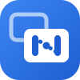

   
  <b>NEADESK</b> — contrôle d'écran à distance, simple et sécurisé 
  <a href="#télécharger">Télécharger</a> •
  <a href="#utiliser-neadesk">Utiliser</a> •
  <a href="#serveur-neadesk">Serveur</a> •
  <a href="#compiler">Compiler</a> •
  <a href="#licence">Licence</a>

NEADESK permet d'aider quelqu'un à distance, ou de se faire aider, en voyant et en contrôlant son écran. Il fonctionne sur **Windows, macOS, Linux et Android** ; l'application iPhone est prête mais pas encore publiée.

La personne aidée garde toujours la main : chaque demande de connexion doit être acceptée sur son écran, elle choisit les autorisations (souris et clavier, fichiers, son…) et peut couper la session à tout moment.

> [!CAUTION]
> N'utilisez NEADESK que sur des appareils pour lesquels vous avez l'accord de leur propriétaire. Tout accès sans autorisation est interdit.

## Télécharger

Les versions de test se trouvent sur la page **[Releases → neadesk-test](https://github.com/daganyigite/NeaDesk/releases/tag/neadesk-test)**.

| Appareil | Fichier à prendre |
|---|---|
| Windows (presque tous les PC) | `neadesk-…-x86_64.exe` (sans installation) ou `.msi` (installateur) |
| Windows sur processeur ARM | `neadesk-…-aarch64.exe` ou `.msi` |
| Mac récent (puce M1, M2, M3…) | `neadesk-…-aarch64.dmg` |
| Mac Intel | `neadesk-…-x86_64.dmg` |
| Linux Ubuntu / Debian | `neadesk-…-x86_64.deb` |
| Autres Linux | `.AppImage`, `.rpm` ou `.flatpak` |
| Android | `neadesk-…-universal.apk` (tous les téléphones) |

**À savoir pour l'installation**

- **Windows** : avant d'installer une nouvelle version, quittez NEADESK (clic droit sur son icône près de l'horloge → Quitter).
- **Mac** : l'application n'est pas encore signée par Apple. À la première ouverture, faites un clic droit sur l'application puis **Ouvrir**.
- **Android** : autorisez l'installation d'applications « de sources inconnues » quand le téléphone le demande.
- **iPhone / iPad** : l'iPhone peut contrôler un autre appareil, mais ne peut pas être contrôlé (limite imposée par Apple). Sa publication demande un compte développeur Apple.

## Utiliser NEADESK

### Se faire aider

1. Ouvrez NEADESK.
2. Donnez votre **identifiant** et votre **mot de passe à usage unique** à la personne qui vous aide. Le bouton **Copier l'invitation** prépare un message prêt à envoyer.
3. Quand la demande s'affiche, vérifiez que vous connaissez la personne, choisissez les autorisations, puis cliquez sur **Accepter**.

### Aider quelqu'un

1. Demandez l'identifiant du poste distant.
2. Saisissez-le dans **Contrôler un poste distant**.
3. Cliquez sur **Se connecter**, puis entrez son mot de passe si on vous le demande.

Pendant la session, la barre du haut affiche le nom du poste, la latence, le nombre d'images par seconde et un cadenas **Chiffré** lorsque la session est chiffrée. Le bouton rouge **Terminer** met fin à la session.

## Serveur NEADESK

Pour que les connexions soient fluides, NEADESK s'appuie sur un serveur proche des utilisateurs :

- **hbbs** : l'annuaire, qui met les appareils en relation ;
- **hbbr** : le relais, utilisé quand une connexion directe entre les deux appareils est impossible.

Ce sont les programmes officiels et libres de [rustdesk-server](https://github.com/rustdesk/rustdesk-server). Ils tournent sur un PC du réseau (pour les tests) ou sur un serveur loué (VPS).

**Ports à ouvrir** : TCP 21115 à 21119 et UDP 21116.

**Réglage dans NEADESK** (sur chaque appareil) : Paramètres → Réseau → Serveur ID/Relais.

| Case | Valeur |
|---|---|
| Serveur ID | adresse du serveur (IP ou nom de domaine) |
| Clé | contenu du fichier `id_ed25519.pub` créé par hbbs |

Laissez les autres cases vides : le relais est trouvé automatiquement.

## Compiler

### Avec GitHub Actions (recommandé)

Les compilations se lancent à la main depuis l'onglet **Actions** du dépôt, et publient les fichiers dans la pré-release `neadesk-test` :

| Workflow | Contenu | Durée |
|---|---|---|
| **NEADESK Windows** (`neadesk-windows.yml`) | Windows x64 uniquement | ≈ 1 h |
| **NEADESK Toutes plateformes** (`neadesk-all.yml`) | Windows, macOS, Linux, Android, iOS | ≈ 1 h 30 |

Une dernière étape renomme automatiquement les fichiers `rustdesk-*` en `neadesk-*` (script `.github/neadesk-renommer.sh`).

### Sur un PC Windows (interface seulement)

Pour tester rapidement un changement d'interface (≈ 3 minutes), sans recompiler le cœur Rust :

1. Installer [Flutter 3.24.5](https://docs.flutter.dev/release/archive) et Visual Studio Build Tools 2022 (charge de travail « Développement Desktop en C++ »), puis activer le **mode développeur** de Windows.
2. Depuis un run GitHub Actions réussi, récupérer :
   - l'artifact `bridge-artifact` → copier `generated_bridge.dart` et `generated_bridge.freezed.dart` dans `flutter/lib/` ;
   - l'artifact `rustdesk-unsigned-windows-x86_64` → copier `librustdesk.dll` dans `target/release/` (et `dylib_virtual_display.dll` dans `target/release/deps/`).
3. Dans `flutter/` : `flutter pub get`, puis `flutter analyze` pour vérifier le code, puis `flutter build windows --release`.

Les textes de l'interface sont stockés dans le cœur Rust (`src/lang/`) : un nouveau texte n'apparaît qu'après une compilation GitHub Actions.

Pour une compilation complète du cœur Rust, voir la [documentation de RustDesk](https://rustdesk.com/docs/en/dev/build/).

## Ce qui est propre à NEADESK

| Élément | Emplacement |
|---|---|
| Nom de l'application | `libs/hbb_common` (fork [neadesk_hbb_common](https://github.com/daganyigite/neadesk_hbb_common), branche `neadesk`) |
| Couleurs et styles de l'interface | `flutter/lib/desktop/widgets/neadesk_style.dart` |
| Écran d'accueil (PC) | `flutter/lib/desktop/pages/desktop_home_page.dart`, `connection_page.dart` |
| Fenêtre de demande entrante (PC) | `flutter/lib/desktop/pages/server_page.dart` |
| Barre de session (PC) | `flutter/lib/desktop/widgets/remote_toolbar.dart` |
| Écrans du téléphone | `flutter/lib/mobile/pages/connection_page.dart`, `server_page.dart` |
| Textes (français et anglais) | `src/lang/fr.rs`, `src/lang/en.rs` (clés `neadesk_*`) |
| Logo et icônes | `neadesk/` (sources SVG, rendus PNG, script `generer_icones.php`) |

Pour régénérer toutes les icônes après une modification du logo : rendre les SVG de `neadesk/sources/` en PNG 1024 px, puis lancer
`php neadesk/generer_icones.php <dossier des PNG> .`

## Licence

NEADESK est basé sur [RustDesk](https://github.com/rustdesk/rustdesk) (© Purslane Tech Pte. Ltd.) et distribué sous la même licence, **[AGPL-3.0](LICENCE)** : le code source, y compris les modifications, reste public.

Le README d'origine de RustDesk est conservé dans [docs/README-RUSTDESK.md](docs/README-RUSTDESK.md).
